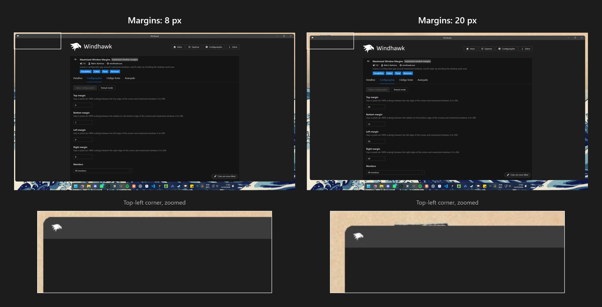
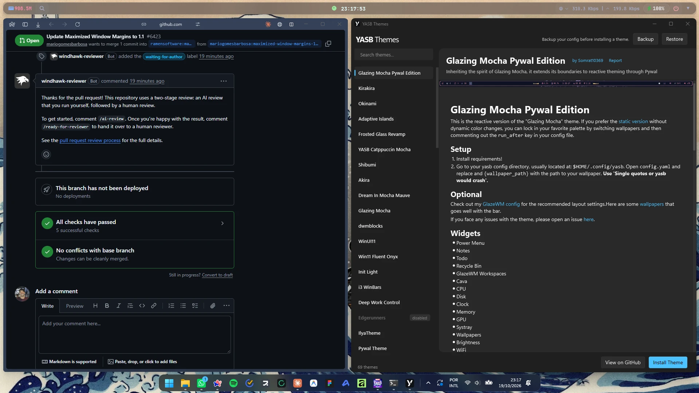

# Maximized Window Margins

A [Windhawk](https://windhawk.net/) mod that leaves a configurable gap around
maximized windows, macOS style. It pairs nicely with a floating dock, such as
the *Luminosity* or *DockLike* themes of **Windows 11 Taskbar Styler**.

## How it works

The mod runs as a *tool mod*: it lives in its own `windhawk.exe` process and
injects nothing into other programs. For each monitor and each edge with a
margin greater than zero, it registers an invisible
[AppBar](https://learn.microsoft.com/windows/win32/shell/application-desktop-toolbars)
of the configured thickness. Windows reduces the work area accordingly, and
every maximized window fits inside it.

- Margins are set in pixels at 100% scaling and scaled per monitor DPI (0–200).
- AppBars are registered again when Explorer restarts, when displays change,
  and when the taskbar or another AppBar moves.
- Disabling the mod restores the original work area immediately.

## Gaps between snapped windows

When two or more windows share the screen through Snap / Snap Layouts (halves,
thirds, quarters...), the mod keeps the "Gap between snapped windows" between
them. Edges that touch the screen keep the regular margins.

- Resizing works as usual: drag the gap itself, or the edge of a snapped
  window, and the windows on both sides resize together while the gap stays
  the same. The Windows 11 divider only shows up while snapped windows touch,
  so the mod provides its own, which works with any gap size.
- Set the gap to 0 to turn this off.
- Disabling the mod puts snapped windows back where Snap placed them.

Under the hood, the mod watches window moves through an out-of-context
[WinEvent hook](https://learn.microsoft.com/windows/win32/api/winuser/nf-winuser-setwineventhook)
(still nothing injected) and fills each gap with an invisible window that
handles the dragging.

## Settings

| Setting        | Default | Description                                   |
| -------------- | ------- | --------------------------------------------- |
| Top margin     | 10      | Gap between the top of the screen and windows |
| Bottom margin  | 10      | Gap above the taskbar / bottom of the screen  |
| Left margin    | 10      |                                               |
| Right margin   | 10      |                                               |
| Gap between snapped windows | 10 | Gap between windows arranged side by side with Snap (0 disables it) |
| Monitors       | All     | All monitors, or the primary monitor only     |

## Side effects

Since the work area itself shrinks, the gap also applies to Snap / Snap Layouts,
desktop icon placement, and anything else that positions itself from the work
area, such as pop-ups and notifications that apps place in a corner of the
screen. Real fullscreen apps (games, videos, F11) cover the whole monitor and
are not affected.

## Rounded corners

Windows 11 squares off maximized windows. To round them, use
[Custom Window Corner Radius](https://windhawk.net/mods/custom-corner-radius)
with "Rounded corners for maximized and snapped windows" set to
"Round snapped and maximized windows".

## Installing manually

1. In Windhawk, click **Create a new mod**.
2. Replace the template with the contents of
   [`maximized-window-margins.wh.cpp`](maximized-window-margins.wh.cpp).
3. Click **Compile Mod**, then adjust the margins in the mod's **Settings** tab.

## License

[MIT](LICENSE)
